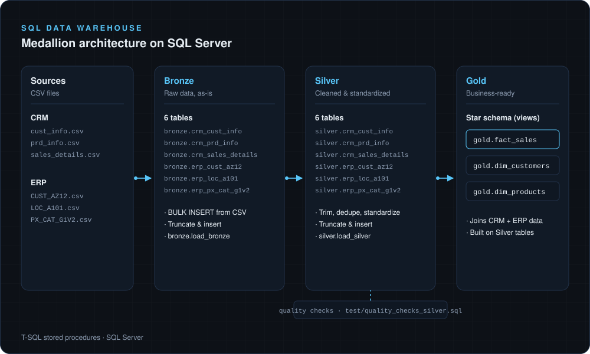
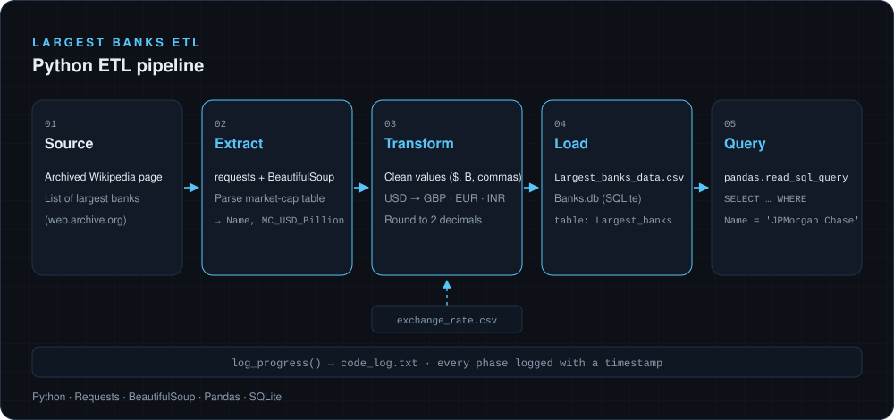
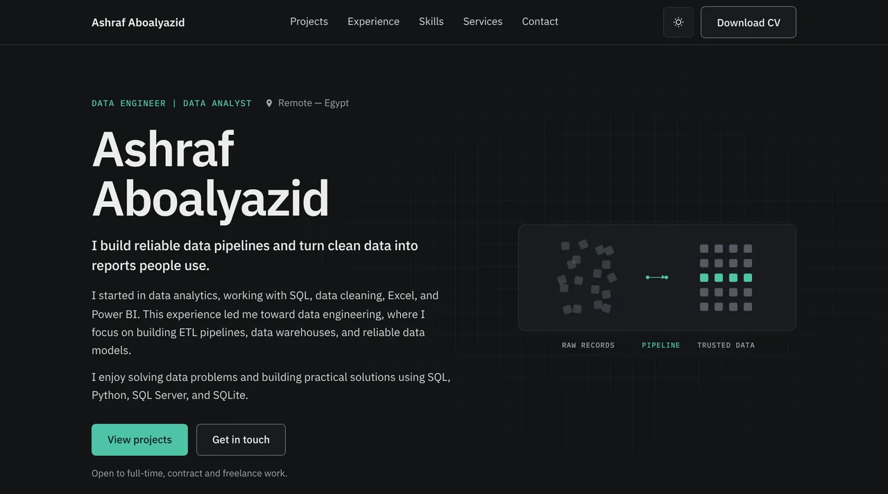

 

<!-- Upwork badge goes here once the profile link is confirmed -->

## About

I'm a Data Engineer focused on building ETL pipelines and SQL-based data warehouses that turn raw, messy data into clean, analytics-ready models.

I started in data analysis, where I spent time on the consuming end of data: cleaning it, modeling it, and building dashboards. That work showed me how much depends on the pipelines underneath, which is what led me to data engineering.

Alongside my technical work, I've taught data and programming to 490+ students.

Based in Egypt · Open to full-time, contract, and freelance opportunities

## Featured Projects

**[SQL Data Warehouse](https://github.com/agaboalyazid/sql-data-warehouse-project)**

A SQL Server data warehouse built on the Medallion architecture (Bronze → Silver → Gold), with T-SQL ETL between layers, a star-schema Gold layer, data-quality checks, and full documentation (architecture, data flow, data catalog, naming conventions). 
`SQL Server` · `T-SQL` · `Data Modeling` · `Star Schema` — Built hands-on following Data with Baraa's SQL Data Warehouse course.

**[Largest Banks ETL Pipeline](https://github.com/agaboalyazid/largest-banks-etl)**

An end-to-end Python ETL pipeline that scrapes the list of the world's largest banks from an archived Wikipedia page, converts market capitalization from USD to GBP, EUR, and INR using exchange rates from a CSV file, loads the result into a CSV file and a SQLite database, runs SQL queries on it, and logs every stage with timestamps. 
`Python` · `Requests` · `BeautifulSoup` · `Pandas` · `SQLite` — Completed as a hands-on project in the IBM Data Engineering Professional Certificate (Coursera).

**Portfolio Website**

My personal site with projects, skills, and certifications. 
Live site: [agaboalyazid.github.io/Portfolio](https://agaboalyazid.github.io/Portfolio/) · Repository: [agaboalyazid/Portfolio](https://github.com/agaboalyazid/Portfolio) 
`HTML` · `CSS` · `JavaScript`

## Tech Stack

| | |
|---|---|
| **Languages** | SQL (T-SQL), Python |
| **Databases** | SQL Server, SQLite · MySQL (basic) |
| **Data Engineering** | ETL / ELT, Data Warehousing, Data Modeling, Medallion Architecture |
| **Python Libraries** | Pandas, Requests, BeautifulSoup |
| **Analytics** | Power BI, Excel |
| **Tools** | Git, GitHub, Jupyter, VS Code |

## Currently Learning

- **Python** — strengthening the fundamentals through hands-on practice
- **SQL Server** — writing and refining SQL queries

## Credentials

- **DataCamp** — Data Engineer Associate Certification
- **DataCamp** — SQL Associate Certification
- **ALX Africa** — Data Analytics Certificate
- **B.Sc. Information Technology** — Kafr El-Sheikh University, 2024

 

Clean Data. Clean Code. Better Decisions.

