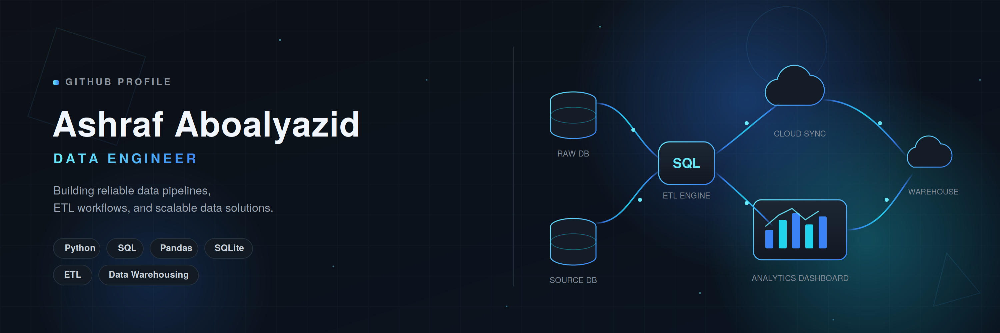

<h3>Data Engineer building ETL pipelines and SQL data warehouses.</h3>

## About Me

I started in data analytics, cleaning data, writing SQL, and building reports, and moved
into data engineering to work on the pipelines that make data reliable in the first place.
I care about data quality and enjoy turning messy data problems into practical solutions.
I've also taught data and programming to 490+ students.

## Technical Skills

| Area | Technologies |
|---|---|
| **Languages** | `SQL (T-SQL)` `Python` |
| **Databases** | `SQL Server` `SQLite` `MySQL (basic)` |
| **Data Engineering** | `ETL / ELT` `Data warehousing` `Data modeling` `Medallion architecture` |
| **Python Libraries** | `Pandas` `Requests` `BeautifulSoup` |
| **Analytics** | `Power BI` `Excel` |
| **Tools** | `Git` `GitHub` `Jupyter` `VS Code` |

## Experience

#### Data Training

| Role | Organization |
|---|---|
| **Data Analytics Intern** Sep 2024 – Mar 2025 | ALX Africa |
| **Data Analyst Specialist** Jun 2024 – Oct 2024 | Digital Egypt Pioneers Initiative (DEPI) |

## Featured Projects

<table>
<tr>
<td width="50%" valign="top">
<b>SQL Data Warehouse</b> 
SQL Server warehouse with a Medallion architecture and star schema, built in T-SQL (following Data with Baraa's course).  
<a href="https://github.com/agaboalyazid/sql-data-warehouse-project">Repository →</a>
</td>
<td width="50%" valign="top">
<b>Largest Banks ETL</b> 
Python pipeline that scrapes, converts, and loads bank market-cap data into SQLite (IBM Data Engineering Professional Certificate project).  
<a href="https://github.com/agaboalyazid/largest-banks-etl">Repository →</a>
</td>
</tr>
</table>

## Contact

